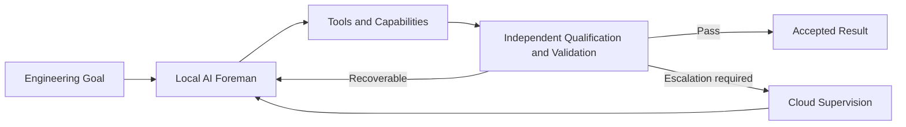

# ACE K2

## Autonomous AI Agent on an AMD Ryzen AI Windows PC

### The AI Proposes. The System Decides.

> **Most AI agents are allowed to mark their own homework. We built one that isn’t.**

ACE K2 is a governed autonomous local engineering system from **NH Applied**.

Give ACE K2 an engineering goal and its local AI foreman works out how to achieve it. It can research the problem, plan the work, use existing tools, identify missing capabilities, and create or acquire new tools when required.

The important difference is that **the AI doing the work is not the authority that decides whether the work passes**.

Separate controls qualify tools, validate outputs, preserve evidence, control recovery and decide whether a result is acceptable.

**Local-first, with on-demand cloud supervision when needed — without putting a per-token cloud API in the core execution loop.**

---

## What ACE K2 does

1. **Understands the goal**  
   The local AI foreman researches the problem, plans the work and chooses how to proceed.

2. **Finds or builds capabilities**  
   Existing tools can be used directly. When a required capability is missing, ACE can create or acquire it inside a governed sandbox.

3. **Qualifies before use**  
   A newly created capability is not trusted merely because the AI produced it. Independent controls qualify it before operational use.

4. **Validates the result**  
   Separate evaluation and control layers determine whether the work has actually passed.

5. **Recovers or escalates**  
   ACE attempts bounded local recovery first. If the problem remains unresolved, it can escalate for cloud supervision, return the answer to the local workflow and continue.

> **The AI is free to solve problems, but it is not free to mark its own homework.**

---

## Demonstrated capabilities

| Evidence | Demonstrated result |
|---|---|
| Governed-autonomy core | **6 / 6** demonstrations |
| Autonomous KiCad engineering | **88 / 88** validation checks, **0 ERC violations** |
| AMD-focused research and engineering project | **23 / 23** project checks, **10 / 10** regression checks |
| Current-web discovery | **26 / 26** checks |
| Large-artifact handling | Exact paged reconstruction of a **1.6 MB** artifact |
| Long-running orchestration | **23 / 23** checks |

These are demonstrated capabilities of the current ACE K2 system, not claims of universal autonomy.

---

## Architecture in one view

The model proposes actions and solutions. Independent controls retain authority over qualification, validation and acceptance.

---

## Demonstrated platform

The current evidence baseline was produced on:

- **AMD Ryzen AI MAX+ 395**
- **AMD Radeon 8060S**
- **128 GB unified memory**
- **Windows 11 Pro**
- **Qwen3.5-35B-A3B-GGUF** local foreman

ACE K2 is an architecture, not a claim that this exact hardware is required.

---

## AMD Strix Halo / MIOpen case study

ACE was applied to an existing public Windows/gfx1151 MIOpen Conv3d issue on Strix Halo. A reduced LTX-style stage-3 workload reproduced a size-dependent failure boundary: a tile-256 control completed with the MIOpen-backed path enabled, while the matched tile-512 case terminated. The same tile-512 geometry completed with `torch.backends.cudnn.enabled = False`, providing a scoped experimental workaround candidate and evidence relevant to the upstream investigation.

The workaround is **not presented as an upstream fix or a confirmed mitigation**. The ACE evaluation remained **INCONCLUSIVE** because repeated validation and numerical-equivalence testing against a declared tolerance were not completed.

- **Technical white paper:** https://doi.org/10.5281/zenodo.23158752
- **GitHub landing page:** [MIOpen Conv3d Failure on AMD Strix Halo under Windows](papers/MIOpen_Conv3d_Strix_Halo_White_Paper_v1.0.md)
- **Upstream issue:** https://github.com/ROCm/TheRock/issues/5845

---

## AMD ROCm #12571 validation case study

ACE K2 independently built and physically validated a source-level correction for **ROCm/rocm-systems issue #12571**, a Windows PAL/SDMA stream-ordering fault in which an SDMA copy issued after `hipEventRecord` can race earlier compute on the same stream and return stale data.

Using matched TheRock/rocm-systems source provenance and the same Windows HIP build route, ACE performed a forced-pristine versus forced-patched causal A/B test on **gfx1151 / Radeon 8060S**, with SDMA enabled in both cases.

- **Pristine build:** targeted read cell reproduced **STALE 50/50**, with the other five controls clean.
- **Patched build:** **all six cells clean 50/50**.
- **Independent evaluator:** **ACCEPT / PATCH_VALIDATED_SDMA_ENABLED**.

The ACE implementation is not source-identical to AMD PR #12952. Both approaches preserve compute-event state across the relevant flush, but ACE uses the retained `lastComputeEvent_` directly for the compute-idle fence, while the AMD implementation preserves the existing live-event path and uses the retained event as a fallback.

The result is deliberately bounded to the tested Windows gfx1151 environment, matched source/runtime revision and governed #12571 reproducer matrix. It is **not** a claim of universal correctness across ROCm platforms or releases.

- **Validation report:** https://doi.org/10.5281/zenodo.23267518
- **Upstream issue:** https://github.com/ROCm/rocm-systems/issues/12571

---

## Read the work

**ACE K2 White Paper v1.2 — Current Capabilities Edition**  
Nigel Hutchinson / NH Applied, September 2026

- **White paper:** https://doi.org/10.5281/zenodo.22869831
- **ROCm #12571 source-level fix validation:** https://doi.org/10.5281/zenodo.23267518
- **MIOpen Conv3d Strix Halo case study:** https://doi.org/10.5281/zenodo.23158752
- **Project overview:** https://nhapplied.co.uk/ace.html
- **Hugging Face:** https://huggingface.co/spaces/nh-applied/ACE-K2
- **NH Applied:** https://nhapplied.co.uk/

---

## Public disclosure boundary

This repository is a public technical landing page, **not a source-code release**.

The public material intentionally describes the architecture, evidence and demonstrated capabilities without publishing reconstruction-enabling implementation details such as complete prompts, schemas, state-machine transition logic, recovery triggers, transport bindings, internal orchestration details, executable file layouts or reproducible build sequences.

---

## Status

**Published current-capabilities baseline.**

ACE K2 is an engineering research system. It does not claim universal task competence, regulatory certification, or that every model/tool combination is qualified.

---

## Author

**Nigel Hutchinson / NH Applied**

Technical discussion, research collaboration or commercial enquiries:  
**contact@nhapplied.co.uk**

Copyright © 2026 Nigel Hutchinson / NH Applied. All rights reserved.
