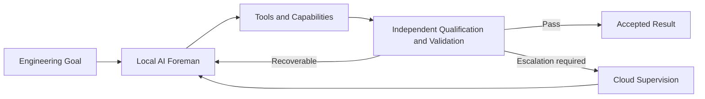

# ACE K2

## Autonomous AI Agent on an AMD Ryzen AI Windows PC

### The AI Proposes. The System Decides.

> **Most AI agents are allowed to mark their own homework. We built one that isn’t.**

ACE K2 is a governed autonomous local engineering system from **NH Applied**.

Give ACE K2 an engineering goal and its local AI foreman works out how to achieve it. It can research the problem, plan the work, use existing tools, identify missing capabilities, and create or acquire new tools when required.

The important difference is that **the AI doing the work is not the authority that decides whether the work passes**.

Separate controls qualify tools, validate outputs, preserve evidence, control recovery and decide whether a result is acceptable.

**Local-first, with on-demand cloud supervision when needed — without putting a per-token cloud API in the core execution loop.**

---

## What ACE K2 does

1. **Understands the goal**  
   The local AI foreman researches the problem, plans the work and chooses how to proceed.

2. **Finds or builds capabilities**  
   Existing tools can be used directly. When a required capability is missing, ACE can create or acquire it inside a governed sandbox.

3. **Qualifies before use**  
   A newly created capability is not trusted merely because the AI produced it. Independent controls qualify it before operational use.

4. **Validates the result**  
   Separate evaluation and control layers determine whether the work has actually passed.

5. **Recovers or escalates**  
   ACE attempts bounded local recovery first. If the problem remains unresolved, it can escalate for cloud supervision, return the answer to the local workflow and continue.

> **The AI is free to solve problems, but it is not free to mark its own homework.**

---

## Demonstrated capabilities

| Evidence | Demonstrated result |
|---|---|
| Governed-autonomy core | **6 / 6** demonstrations |
| Autonomous KiCad engineering | **88 / 88** validation checks, **0 ERC violations** |
| AMD-focused research and engineering project | **23 / 23** project checks, **10 / 10** regression checks |
| Current-web discovery | **26 / 26** checks |
| Large-artifact handling | Exact paged reconstruction of a **1.6 MB** artifact |
| Long-running orchestration | **23 / 23** checks |

These are demonstrated capabilities of the current ACE K2 system, not claims of universal autonomy.

---

## Architecture in one view

The model proposes actions and solutions. Independent controls retain authority over qualification, validation and acceptance.

---

## Demonstrated platform

The current evidence baseline was produced on:

- **AMD Ryzen AI MAX+ 395**
- **AMD Radeon 8060S**
- **128 GB unified memory**
- **Windows 11 Pro**
- **Qwen3.5-35B-A3B-GGUF** local foreman

ACE K2 is an architecture, not a claim that this exact hardware is required.

---

## Read the work

**ACE K2 White Paper v1.2 — Current Capabilities Edition**  
Nigel Hutchinson / NH Applied, September 2026

- **White paper:** https://doi.org/10.5281/zenodo.22869831
- **Project overview:** https://nhapplied.co.uk/ace.html
- **Hugging Face:** https://huggingface.co/spaces/nh-applied/ACE-K2
- **NH Applied:** https://nhapplied.co.uk/

---

## Public disclosure boundary

This repository is a public technical landing page, **not a source-code release**.

The public material intentionally describes the architecture, evidence and demonstrated capabilities without publishing reconstruction-enabling implementation details such as complete prompts, schemas, state-machine transition logic, recovery triggers, transport bindings, internal orchestration details, executable file layouts or reproducible build sequences.

---

## Status

**Published current-capabilities baseline.**

ACE K2 is an engineering research system. It does not claim universal task competence, regulatory certification, or that every model/tool combination is qualified.

---

## Author

**Nigel Hutchinson / NH Applied**

Technical discussion, research collaboration or commercial enquiries:  
**contact@nhapplied.co.uk**

Copyright © 2026 Nigel Hutchinson / NH Applied. All rights reserved.
